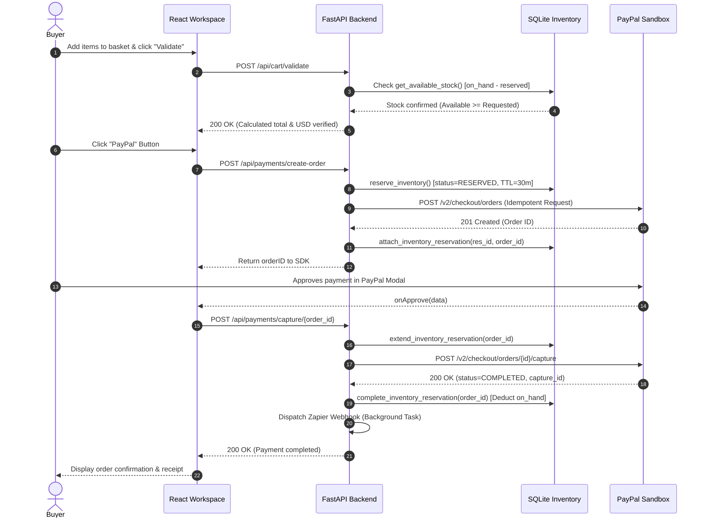

# AgentPay

> **Autonomous AI Commerce Agent with Human-in-the-Loop Approval, Transactional Inventory & PayPal Sandbox Integration**  
> *PayPal AI Hackathon Prototype*

AgentPay is an AI-powered shopping assistant and commerce workspace that researches products, compares real-time retailer offers, maintains ACID-compliant inventory reservations, and enables secure buyer checkout via PayPal Sandbox.

AgentPay is built on a strict **Human-in-the-Loop (HITL)** architecture: **AI agents never possess autonomous payment execution authority**. All financial transactions, recurring subscriptions, and inventory deductions require explicit, server-validated buyer consent and verified PayPal captures.

---

## 🌟 Key Features & Multi-Page Workspace

AgentPay features a modular, multi-page workspace organized into five specialized operator and shopper views:

```
┌────────────────────────────────────────────────────────────────────────┐
│                              AGENTPAY                                  │
├─────────────────┬──────────────────────────────────────────────────────┤
│ 🛍️ Shopping     │ Prompt Planning · Visual Studio · AG Grid · Checkout │
│ 💳 Subscriptions│ Premium Plan · Recurring Billing · Merchant KPIs     │
│ 📦 Inventory    │ Real-Time Stock · 30m Holds · Adjustments · Audit Log│
│ ⚡ Orders & Pay │ Captured Orders · Partial/Full Refunds · PayPal MCP   │
│ 🔍 Observability│ Elastic Traces · Audit Timeline · Health Diagnostics │
└─────────────────┴──────────────────────────────────────────────────────┘
```

### 1. 🛍️ Shopping Agent (`/` workspace view)
- **Natural Language Shopping Planner**: Interprets multi-constraint prompts (e.g., *"Build me a work-from-home setup under $80"*), extracts USD budgets, and suggests coordinated baskets.
- **Visual Shopping Studio (Image-to-Product)**: Drag-and-drop reference photo search powered by Channel3's visual discovery engine (`POST /api/agent/photo`).
- **Live Catalog & Retailer Discovery**: Live in-stock USD offers from Channel3 with high-resolution imagery and direct merchant links, backed by a deterministic local demo fallback.
- **AG Grid Retailer Intelligence**: AG Grid Community data grid enabling sorting, filtering, and side-by-side comparison of merchant offers, conditions, and stock availability.
- **Conversational Refinement Agent**: Multi-turn contextual chat (`POST /api/agent/chat`) to discover alternatives, ask questions, or tighten budget constraints while preserving conversation context.
- **Interactive Checkout Rail**: Server-validated basket calculation with live PayPal checkout buttons (`PayPalOneTimePaymentButton` via `@paypal/react-paypal-js/sdk-v6`).

### 2. 💳 Subscriptions Center
- **AgentPay Premium Checkout**: Buyer-facing recurring billing subscription card ($9.99/month) powered by PayPal Subscriptions v1/v2 API and `PayPalSubscriptionButton`.
- **Merchant Subscription Dashboard**: Real-time read-only visibility into merchant recurring revenue, active subscribers, suspended accounts, failed payment retry statuses, and next billing schedules (`GET /api/subscriptions`).
- **Subscription Inspection Drawer**: Detailed modal view for subscriber IDs, billing cycles, last payment timestamps, and outstanding balances.

### 3. 📦 Real-Time Transactional Inventory Engine (v1)
- **Persistent SQLite Datastore**: Dedicated ACID tables tracking `on_hand`, `reserved`, and `available` (`on_hand - reserved`) stock quantities.
- **Atomic Pre-Order Reservations**: Atomically reserves stock (`reserve_inventory`) for 30 minutes before creating the PayPal order to prevent overselling.
- **Confirmed-Capture Deductions**: Permanently commits and deducts on-hand stock (`complete_inventory_reservation`) only after PayPal confirms capture status as `COMPLETED`.
- **Safe Release on Failure/Abandonment**: Automatically releases reservations on buyer cancellation, network timeouts, or order creation errors (`release_inventory_reservation_by_id`).
- **Operator Stock Adjustments**: Fast "+ Add" and "− Deduct" stock adjustment controls with audit notes and historical ledger logging (`inventory_movements`).

### 4. ⚡ Orders & Payment Lifecycle
- **Captured Sandbox Payments**: Chronological ledger of all Sandbox transactions, PayPal order IDs, and capture IDs stored locally in SQLite (`payment_orders`).
- **Full & Partial Refunds**: Direct integration with PayPal's capture refund API (`POST /api/payments/refund/{order_id}`) with remaining balance tracking, reason notes, and idempotency protection.
- **PayPal Agent Toolkit / MCP Bridge**: Read-only Model Context Protocol (MCP) tool discovery and execution via `@paypal/agent-toolkit-mcp`.
- **Post-Purchase Automations**: Real-time webhook dispatch to Zapier Catch Hooks upon confirmed payment capture (`ZAPIER_WEBHOOK_URL`), with manual retry controls.

### 5. 🔍 Observability & Telemetry
- **Elasticsearch Audit Traces**: Seamless indexing of system events, shopping planning steps, stock adjustments, and PayPal payment states into Elastic Cloud / Elasticsearch.
- **Privacy-Conscious Audit Log**: Excludes raw credit card numbers, passwords, buyer tokens, and proprietary payloads.
- **In-Memory Fallback**: Fully functional in-memory event stream if Elasticsearch is not configured or offline.

---

## 🔒 Transactional Checkout Lifecycle



---

## 🛠️ Tech Stack

| Layer | Technologies |
|---|---|
| **Frontend** | React 18, TypeScript, Vite, `@paypal/react-paypal-js` (SDK v6), AG Grid Community, Lucide React |
| **Backend** | Python 3.11+, FastAPI, Uvicorn, HTTPX (Async), SQLite3, Pydantic v2 |
| **AI & Search** | Channel3 Agentic Search API, Channel3 Conversational Agent API, Channel3 Image Discovery |
| **Payments** | PayPal Orders v2 API, PayPal Subscriptions v1/v2 API, PayPal Webhooks API |
| **Agents & MCP** | PayPal Agent Toolkit MCP (`@paypal/agent-toolkit-mcp`) |
| **Observability**| Elastic Cloud (Elasticsearch 8+), In-Memory Ring Buffer |
| **Integrations** | Zapier Catch Hooks, APIMatic Developer Plugin, Postman Collection |

---

## 🚀 Quickstart Guide

### Prerequisites
- **Python 3.11+**
- **Node.js 20+** and **npm**
- **PayPal Developer Account** with a Sandbox REST App & Sandbox Personal Buyer Account

---

### Step 1: Backend Setup

1. Open a terminal and navigate to the backend directory:
   ```bash
   cd backend
   ```

2. Create and activate a Python virtual environment:
   ```bash
   python3 -m venv .venv
   source .venv/bin/activate
   ```

3. Install required Python packages:
   ```bash
   pip install -r requirements.txt
   ```

4. Configure environment variables:
   ```bash
   cp .env.example .env
   ```
   Edit `backend/.env` with your Sandbox credentials:
   ```dotenv
   PAYPAL_CLIENT_ID=your_sandbox_client_id
   PAYPAL_CLIENT_SECRET=your_sandbox_client_secret
   PAYPAL_BASE_URL=https://api-m.sandbox.paypal.com

   # Channel3 API Key (Get a key at https://trychannel3.com/developers)
   CHANNEL3_API_KEY=your_channel3_api_key

   # SQLite database path (default: agentpay.db)
   AGENTPAY_DB_PATH=agentpay.db

   # Admin operator token (for protected refunds/inventory endpoints)
   AGENTPAY_ADMIN_TOKEN=db9564baea7c375df8781732c0961a59d91991480814c69b8a418db39d9910b8
   ```

5. Launch the FastAPI development server:
   ```bash
   uvicorn app.main:app --reload --port 8000
   ```
   *FastAPI documentation will be accessible at http://127.0.0.1:8000/docs.*

---

### Step 2: Frontend Setup

1. In a second terminal, navigate to the frontend directory:
   ```bash
   cd frontend
   ```

2. Install dependencies:
   ```bash
   npm install
   ```

3. Configure frontend environment variables:
   ```bash
   cp .env.example .env
   ```
   Edit `frontend/.env`:
   ```dotenv
   VITE_API_BASE_URL=http://localhost:8000
   VITE_PAYPAL_CLIENT_ID=your_sandbox_client_id
   VITE_PAYPAL_SUBSCRIPTIONS_CLIENT_ID=your_sandbox_subscriptions_client_id
   VITE_AGENTPAY_ADMIN_TOKEN=db9564baea7c375df8781732c0961a59d91991480814c69b8a418db39d9910b8
   ```

4. Start the Vite development server:
   ```bash
   npm run dev
   ```
   *Open your browser at http://localhost:5173.*

---

## ⚙️ Environment Variables Reference

### Backend (`backend/.env`)

| Variable | Required | Default | Description |
|---|---|---|---|
| `PAYPAL_CLIENT_ID` | **Yes** | — | PayPal Sandbox REST App Client ID |
| `PAYPAL_CLIENT_SECRET` | **Yes** | — | PayPal Sandbox REST App Secret |
| `PAYPAL_BASE_URL` | **Yes** | `https://api-m.sandbox.paypal.com` | PayPal Sandbox API endpoint |
| `PAYPAL_WEBHOOK_ID` | No | `""` | PayPal Webhook ID for signature verification |
| `AGENTPAY_DB_PATH` | No | `agentpay.db` | Local SQLite database filename |
| `AGENTPAY_ADMIN_TOKEN` | No | `db9564...` | Shared secret protecting refunds & inventory mutations |
| `CHANNEL3_API_KEY` | No | `""` | Channel3 live search & visual shopping key |
| `CHANNEL3_SEARCH_MODE` | No | `agentic` | Search mode (`agentic` enables multi-constraint parsing) |
| `PAYPAL_SUBSCRIPTIONS_CLIENT_ID` | No | `""` | PayPal Client ID for Subscriptions merchant |
| `PAYPAL_SUBSCRIPTIONS_SECRET` | No | `""` | PayPal Client Secret for Subscriptions merchant |
| `PAYPAL_SUBSCRIPTIONS_PLAN_ID` | No | `""` | Pre-created PayPal Subscription Plan ID (`P-...`) |
| `ZAPIER_WEBHOOK_URL` | No | `""` | Optional Zapier Catch Hook for post-purchase automation |
| `PAYPAL_MCP_ENABLED` | No | `true` | Enables `@paypal/agent-toolkit-mcp` bridge |
| `ELASTICSEARCH_URL` | No | `""` | Elastic Cloud / Elasticsearch endpoint |
| `ELASTIC_API_KEY` | No | `""` | Elasticsearch API key for event indexing |

### Frontend (`frontend/.env`)

| Variable | Required | Default | Description |
|---|---|---|---|
| `VITE_API_BASE_URL` | **Yes** | `http://localhost:8000` | FastAPI backend URL |
| `VITE_PAYPAL_CLIENT_ID` | **Yes** | — | PayPal Sandbox Client ID |
| `VITE_PAYPAL_SUBSCRIPTIONS_CLIENT_ID` | No | — | Sandbox Client ID for subscriptions button |
| `VITE_AGENTPAY_ADMIN_TOKEN` | No | `db9564...` | Auto-authenticates operator dashboard tabs |

---

## 🗄️ Database Architecture (SQLite)

AgentPay maintains local ACID-compliant persistence inside SQLite (`agentpay.db`):

- **`inventory_items`**: Authoritative on-hand, reserved, and threshold counts for finite-stock catalog products.
- **`inventory_reservations`**: Active and completed holds with timestamps, TTL expirations (30m), and order IDs.
- **`inventory_reservation_items`**: Line-item quantities mapped to reservations.
- **`inventory_movements`**: Immutable audit ledger logging all stock actions (`RESTOCK`, `RESERVE`, `COMMIT`, `RELEASE`, `ADJUST`).
- **`payment_orders`**: Captured PayPal orders, amounts, refund states, and inventory linkage.
- **`paypal_webhook_events`**: Idempotency ledger preventing double-processing of duplicate PayPal webhook deliveries.
- **`post_purchase_runs`**: Dispatch logs and retry status for external Zapier webhooks.

---

## 🧪 Testing & Verification

AgentPay features a comprehensive testing suite verifying all business logic, inventory safety, and frontend types:

### 1. Pytest Backend Suite (22 Tests)
Runs unit tests for budget extraction, Channel3 response normalization, subscription normalization, and offer selection:
```bash
PYTHONPATH=backend .venv/bin/pytest backend/tests
```

### 2. Comprehensive Smoke Test Suite (26 Tests)
Validates all FastAPI routes, atomic reservations, stock rejections, adjustments, and telemetry:
```bash
.venv/bin/python3 scratch/comprehensive_smoke_test.py
```

### 3. Frontend TypeScript & Production Build
Ensures zero type errors and validates asset bundling:
```bash
cd frontend
npx tsc --noEmit
npm run build
```

---

## 🛡️ Security & Responsible AI Principles

1. **Human-in-the-Loop Approval**:
   LLMs and AI agents can plan, filter, compare, and recommend, but **cannot capture payments autonomously**. A human buyer must explicitly click the official PayPal button and authenticate the transaction.
2. **Server-Side Price Authority**:
   Client-submitted basket prices and stock counts are **never trusted**. The backend validates every SKU, recalculates line totals, enforces budget bounds, and quantizes amounts to two decimal places before calling PayPal.
3. **Atomic Stock Protection**:
   Inventory is atomically checked and held using SQLite immediate transactions (`BEGIN IMMEDIATE`) and Python locks to prevent concurrent overselling.
4. **Credential Isolation**:
   PayPal Client Secrets and Elasticsearch credentials remain strictly backend-only. The frontend receives only public Client IDs and scoped runtime configuration.

---

## 📁 Repository Structure

```
agentpay-integrated-v6/
├── backend/
│   ├── app/
│   │   ├── main.py               # FastAPI application & REST routing
│   │   ├── config.py             # Pydantic BaseSettings configuration
│   │   ├── catalog.py            # Demo product catalog
│   │   ├── channel3.py           # Channel3 agentic search & conversational API
│   │   ├── inventory_service.py  # SQLite ACID inventory & reservation engine
│   │   ├── paypal.py             # PayPal Orders v2 & Refunds API client
│   │   ├── subscriptions.py      # PayPal Subscriptions API client
│   │   ├── paypal_mcp.py         # PayPal Agent Toolkit MCP bridge
│   │   ├── state_store.py        # SQLite persistent storage manager
│   │   ├── automation_service.py # Post-purchase Zapier automation dispatcher
│   │   └── elastic_service.py    # Elasticsearch telemetry indexer
│   ├── tests/                    # Pytest test cases
│   ├── requirements.txt          # Python dependencies
│   └── agentpay.db               # SQLite database
├── frontend/
│   ├── src/
│   │   ├── App.tsx                           # Multi-page React application
│   │   ├── SubscriptionManagement.tsx        # Merchant subscriptions dashboard
│   │   ├── AgentPaySubscriptionCheckout.tsx  # PayPal subscription button
│   │   ├── InventoryManagement.tsx           # Inventory & stock operations UI
│   │   ├── styles.css                        # Design system & responsive layout
│   │   └── InventoryManagement.css           # Inventory dashboard styling
│   ├── package.json                          # Node dependencies
│   └── vite.config.ts                        # Vite build configuration
├── docs/                                     # Extended documentation guides
└── scratch/                                  # Smoke test scripts
```

---

## 📜 License & Disclaimers

- Built for the **PayPal AI Hackathon 2026**.
- This is a hackathon demonstration and prototype intended for **PayPal Sandbox testing only**.
- Channel3 search results provide live product discovery and retailer offer URLs; demo checkouts simulate payment collection for testing purposes and do not fulfill physical orders with third-party retailers.
